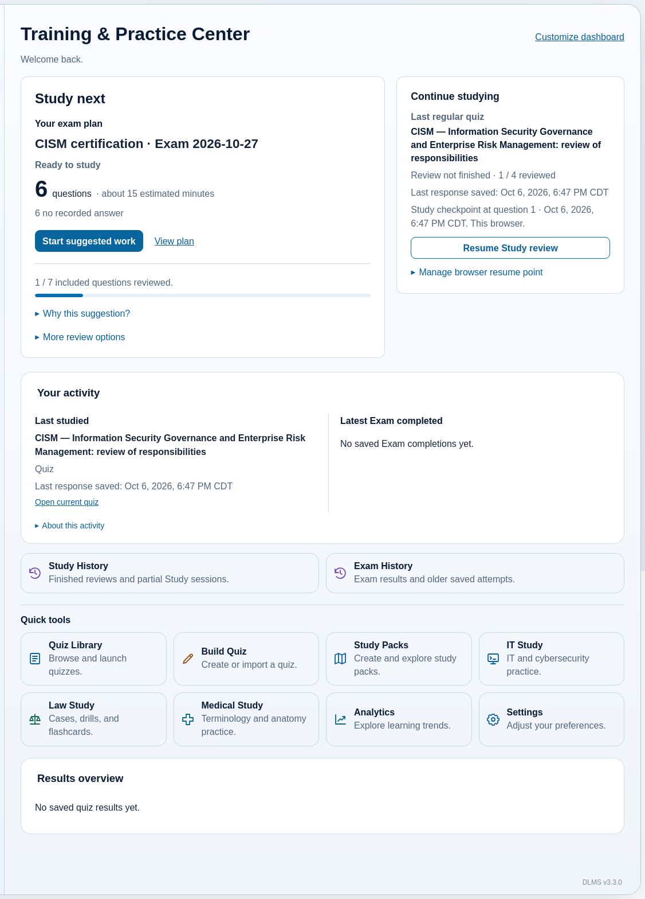
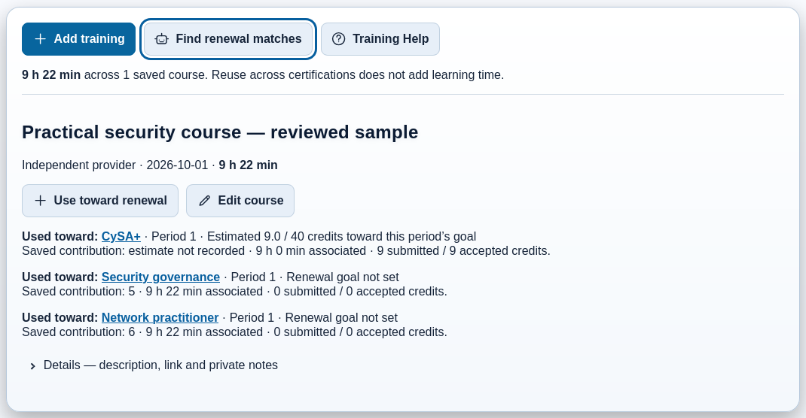

# 🚀 DLMS — make your own material work for you

**Build quizzes. Practice with purpose. Keep your learning history yours.**

> **New prereleases:** Original **3.3.2 RC1** and Desktop **3.3.2 Preview 1**.
> Both retain the shared application label `3.3.2 RC1`; neither is a stable release.
> Original 3.3.1 remains the published stable option.

DLMS is a free, open-source learning workspace for students, certification candidates,
professionals tracking continuing education, and anyone studying independently.
Turn your notes, PDFs, screenshots and question banks into practice; use feedback,
history and focused review to decide what to study next.

**Run it on your computer, with your data stored locally by default.** No hosted
account or cloud deployment is required. Choose your browser or a dedicated Desktop
window; both support local study.

**[⬇️ Get DLMS](#downloads)** · **[📚 Read the user manual](docs/user-manual/README.md)** ·
**[🎬 Watch a tour](#videos)** · **[🌐 Compare editions](#choose-your-dlms)**

## 📸 A look inside

*The Dashboard brings your next study action, optional exam plan and recent work
together. Existing repository screenshot with fictional sample data; it illustrates
an established workflow, not a new 3.3.1 feature. Select it to view full size.*

## ✨ Your learning workspace

These are **existing DLMS capabilities**, brought together in both editions.
The changes in 3.3.2 RC1 and earlier 3.3.1 maintenance fixes are listed separately below.

| Make progress with… | What you can do | Learn more |
| --- | --- | --- |
| 📖 Study and assessment | Get explanations in Study Mode, take timed Exam attempts, resume eligible unfinished work, and keep Study History separate from Exam results. | [Taking quizzes](docs/user-manual/06-taking-quizzes.md) |
| 🧭 Focused review | Start with **Study next**, review due questions and weak concepts, inspect Learning Intelligence, and set optional Exam Plans. | [Study and review](docs/user-manual/07-study-and-review.md) · [Exam Plans](docs/user-manual/exam-plans.md) |
| 📥 Content import | Create or paste questions; import text, selectable PDFs, screenshots and supported scans with local OCR. Inspect uncertain content in **Review & Repair** before saving. | [Creating content](docs/user-manual/04-creating-and-importing-content.md) · [PDF and OCR](docs/user-manual/10-pdf-smart-pdf-and-ocr.md) |
| 🧩 Rich, reusable material | Practice single/multiple-answer questions, matching, terminology, images and hotspots. Organize folders, mix quizzes, inspect duplicates, and reuse Study Packs and subject workspaces. | [Library](docs/user-manual/05-quiz-library-and-organization.md) · [Images and hotspots](docs/user-manual/11-matching-terminology-and-image-based-content.md) · [Study Packs](docs/user-manual/13-study-packs-and-content-packs.md) |
| 🏅 Certifications and training | Record earned credentials, certificate evidence, training hours and renewal dates. Keep estimated, submitted and user-recorded accepted credit distinct; DLMS does not grant issuer approval. | [Certifications and training](docs/user-manual/certifications-and-training.md) |
| 🗂️ Flashcards beyond DLMS | Export selected study material as text front/back Anki cards, or prepare printable Avery 5388 cards. Anki is a separate app; interactive matching/hotspot behavior is not embedded in its cards. | [Anki and printable cards](docs/user-manual/14-anki-decks-and-printable-cards.md) |
| 💾 Backups and portability | Create and validate portable backups, review a restore before applying it, and move supported quiz bundles or packs through their own import/export workflows. | [Backup and restore](docs/user-manual/17-maintenance-backup-and-data-management.md) · [Portability](docs/user-manual/15-import-export-and-portability.md) |
| 🎨 A workspace that fits | Choose among 26 manual themes, personalize dashboard/sidebar visibility, and use keyboard-friendly study controls. | [Settings and runtime](docs/user-manual/16-settings-and-runtime.md) |

**Optional AI, under your control.** DLMS prepares prompts and validates returned
content; you choose what to copy to an external tool and what to bring back.
There is no automatic provider API submission. Material you deliberately share
with another service is subject to that service's privacy terms.
[Explore external AI workflows](docs/user-manual/12-external-ai-workflows.md).

*Record a course once and explicitly associate it with relevant renewals, without
multiplying its actual learning time. Existing sample-data screenshot; recorded
credit is not automatic issuer acceptance.*

## 🎬 See DLMS in action

- **[DLMS 3.3 overview](https://www.youtube.com/watch?v=axmym1glqD8):** tour Study, practice, Exam Plans and certification tracking in the current 3.3 learning workspace.
- **[DLMS Desktop walkthrough](https://www.youtube.com/watch?v=mPGNbPy56X8):** see Local and Server modes demonstrated on Linux. Use the platform-specific installation notes for Windows or Mac.

### Learn a workflow

| Topic | Watch | What it covers |
| --- | --- | --- |
| Import and repair | [Importing study material (3.2)](https://www.youtube.com/watch?v=NYHebz8zMII) | PDF/screenshot import and checking uncertain questions. |
| Study sessions | [Save, resume and review](https://www.youtube.com/watch?v=S_Ww32o9pjQ) | Save work, resume an eligible session and review its history. |
| Practice mistakes | [Turn mistakes into practice](https://www.youtube.com/watch?v=aBpnGRC7Ak8) | Build focused practice from saved Study mistakes. |
| Exam preparation | [Create an Exam Plan](https://www.youtube.com/watch?v=HD414oJfELQ) | Create and use an optional Exam Plan. |
| Certifications | [Certifications, badges and PDFs](https://www.youtube.com/watch?v=qkLXsUSmVno) | Record credentials, badge artwork and certificate evidence. |
| Training and renewal | [Training and renewal progress](https://www.youtube.com/watch?v=boQPakaQlSk) | Log learning time and track recorded renewal progress. |
| Selected questions | [Mark questions for practice and Anki](https://www.youtube.com/watch?v=hya5DsFD3Sc) | Mark questions for further practice and Anki. |
| Flashcards | [Anki and printable cards (3.2)](https://www.youtube.com/watch?v=dG4OA2FV0fI) | Export Anki cards and prepare printable layouts. |
| Protect your data | [Backup, restore and rollback](https://www.youtube.com/watch?v=eNSfwEzA1Bc) | Back up, review a restore and understand rollback limits. |

The public import and printable-card tutorials were recorded for **3.2**; their
retained workflows remain useful, while current written guidance covers later
wording and maintenance fixes. Videos demonstrate features rather than platform
acceptance. [Video titles and manual companions](docs/demo-video/series/README.md#public-walkthroughs)
help you go further. These capabilities predate the 3.3.1 maintenance fixes below.

## 🌐 Browser or 🖥️ Desktop? Choose what suits you

| | 🌐 Original DLMS 3.3.2 RC1 — maintenance candidate | 🖥️ DLMS Desktop 3.3.2 Preview 1 |
| --- | --- | --- |
| Your interface | Opens in your preferred web browser. | Opens in its own application window. |
| Local use | The downloaded application runs on your computer and serves the local browser UI. No separate hosted server is needed. | **Local** starts and manages a backend for the selected Desktop profile. No separate server setup is needed. |
| Server use | Can deliberately host a dataset on a configured machine; a browser accesses that server's data. | **Server** connects to an existing compatible server; it uses that server's data, not a synchronized Local copy. |
| Choose it when… | You want your familiar browser or a deliberately managed server, and accept maintenance-candidate limits; 3.3.1 remains the stable option. | You prefer a dedicated window and profile/mode controls, and accept the platform preview limits. |
| Downloads | Fedora 44, Ubuntu 24.04/26.04, Windows 11 x86_64; Apple Silicon Mac. | Linux x86_64 AppImage, Windows 11 x86_64 installer, Apple Silicon Mac DMG. |

**A browser is an interface, not a cloud requirement.** Core Local workflows and
packaged OCR run locally. Remote servers, videos and external services need their
respective connections. Desktop does **not** automatically import, merge or
synchronize another edition's data. Keep live data directories separate.

For the new readable-encrypted certificate handling in Server mode, use an
**Original 3.3.2 RC1 server** or its matching corrected shared source. Existing
3.3.1 servers retain their own behavior; updating Desktop Local does not update
an older server. Earlier deployments differ by source and may lack fixes. DLMS is a
single-user application with no built-in server account authentication or TLS;
never expose its port directly to the public Internet. See
[edition, data-location and server guidance](docs/choose-your-dlms.md).

## ⬇️ Download Original DLMS 3.3.2 RC1 — maintenance candidate

**Choose one package matching your operating system and architecture.** Ordinary
users do not need Python, build tools or the large source archives to run it.

| Your system | App package |
| --- | --- |
| Fedora 44 x86_64 | [Download Fedora](https://github.com/drakahari/DLMS_next/releases/download/v3.3.2-rc1/DLMS-3.3.2-RC1-fedora44-x86_64.tar.gz) |
| Ubuntu 24.04 x86_64 | [Download Ubuntu 24.04](https://github.com/drakahari/DLMS_next/releases/download/v3.3.2-rc1/DLMS-3.3.2-RC1-ubuntu24.04-x86_64.tar.gz) |
| Ubuntu 26.04 x86_64 | [Download Ubuntu 26.04](https://github.com/drakahari/DLMS_next/releases/download/v3.3.2-rc1/DLMS-3.3.2-RC1-ubuntu26.04-x86_64.tar.gz) |
| Windows 11 x86_64 | [Download Windows ZIP](https://github.com/drakahari/DLMS_next/releases/download/v3.3.2-rc1/DLMS-3.3.2-RC1-windows11-x86_64.zip) |
| Apple Silicon Mac arm64 | [Download Mac ZIP](https://github.com/drakahari/DLMS_next/releases/download/v3.3.2-rc1/DLMS-3.3.2-RC1-macos-arm64.zip) |

Extract the archive first, then run its DLMS executable. On Mac, open the extracted
`DLMS.app` in Finder. The Mac ZIP has `DLMS.app`, `README.txt` and `sample_quiz.txt`
directly at its root. The original interface normally opens at
[http://127.0.0.1:9001/](http://127.0.0.1:9001/).

[Release notes and all assets](https://github.com/drakahari/DLMS_next/releases/tag/v3.3.2-rc1) ·
[SHA256SUMS.txt](https://github.com/drakahari/DLMS_next/releases/download/v3.3.2-rc1/SHA256SUMS.txt) ·
[Installation and first launch](docs/user-manual/02-installation-and-first-launch.md)

**Prefer the published stable edition?** [Original 3.3.1](https://github.com/drakahari/DLMS_next/releases/tag/v3.3.1) remains available with its historical packages and records.

## ⬇️ Download DLMS Desktop 3.3.2 Preview 1

**These are prereleases using the shared `3.3.2 RC1` application.** Candidate
identifiers and some bundled prepublication wording are retained. Windows uses
candidate2, which replaces the rejected packaging-environment candidate1.
The platform release notes describe the exact validation and signing limits.

| Your system | App download | Notes and checksums |
| --- | --- | --- |
| Linux x86_64 | [AppImage](https://github.com/drakahari/DLMS_next/releases/download/desktop-v3.3.2-preview1-linux/DLMS-Desktop-3.3.2-preview1-candidate1-linux-x86_64.AppImage) | [Linux Preview 1](https://github.com/drakahari/DLMS_next/releases/tag/desktop-v3.3.2-preview1-linux) |
| Windows 11 x86_64 | [Setup.exe](https://github.com/drakahari/DLMS_next/releases/download/desktop-v3.3.2-preview1-windows/DLMS-Desktop-WebView2-Windows-x86_64-windows-332-preview1-candidate2-Setup.exe) | [Windows Preview 1](https://github.com/drakahari/DLMS_next/releases/tag/desktop-v3.3.2-preview1-windows) |
| Apple Silicon Mac arm64 | [DMG](https://github.com/drakahari/DLMS_next/releases/download/desktop-v3.3.2-preview1-macos/DLMS-Desktop-3.3.2.RC1-macos-arm64-preview1-candidate.dmg) | [Mac Preview 1](https://github.com/drakahari/DLMS_next/releases/tag/desktop-v3.3.2-preview1-macos) |

[Previous Desktop 3.3.1 previews](https://github.com/drakahari/DLMS_next/releases) remain available.

**Linux:** make the AppImage executable and open it. Normal mounting needs FUSE;
follow the [Linux opening/extraction guide](docs/choose-your-dlms.md#open-desktop-on-linux)
if FUSE is unavailable. Keep Chromium sandboxing enabled. The separate managed
payload is for its existing launcher/profile contract, not a drop-in AppImage upgrade.
Ubuntu 26.04 can report GVFS/portal/graphics fallback warnings despite successful
opening and local file selection. These are disclosed integration limits, not
a failed app test by themselves. [Current platform notes](docs/releases/3.3.2-rc1.md#ubuntu-26-04-warnings).

**Windows:** requires .NET Framework 4.8 and protected machine-wide WebView2 Evergreen
**155.0.4283.45 or newer**. Setup installs neither prerequisite; per-user/AppData-only
WebView2 is unsupported. The installer was compiled and automatically checked,
**not executed** in this qualification. See [Windows opening steps](docs/choose-your-dlms.md#install-and-open-desktop-on-windows).

**Mac:** open the DMG and copy `DLMS Desktop.app` to Applications. Apple Silicon only;
automated evidence is from macOS **26.6.2**, with manual Mac acceptance untested.
Mac apps are ad hoc signed without Developer ID/notarization. Use only the offered
per-app **System Settings → Privacy & Security → Open Anyway** approval for a trusted
download. Stop on malware, damage or policy blocks; do not remove quarantine or
disable Gatekeeper. Linux/Windows downloads are unsigned; keep OS protections enabled.
[Mac opening steps](docs/choose-your-dlms.md#install-and-open-desktop-on-mac).

## 🛠️ What changed in 3.3.2 RC1?

This maintenance candidate builds on 3.3.1; the learning capabilities above remain
available in both editions.

- Readable certificate PDFs with restrictions or an empty opening password can be
  attached without treating them as genuinely password-locked. Locked, malformed
  and active-content PDFs remain rejected, with the existing safety limits.
- PDF/image dependencies are updated, including pypdf 6.21.4 and Pillow 13.0.0.
- Windows preview packaging keeps the displayed RC label while using valid
  numeric Windows metadata. Its final candidate2 also corrects ambient DLL
  contamination in the build environment; it is the offered installer.
- Firefox release-gate synchronization and CI partitioning were corrected while
  retaining the full 390-case coverage. These are validation improvements, not
  new learning features.

[Changes, downloads and platform limits](docs/releases/3.3.2-rc1.md).

## 🛠️ Previous maintenance: what changed in 3.3.1?

3.3.1 is a **maintenance release**, not the introduction of the learning features
above. Relative to the published 3.3.0 baseline, it brings together shared fixes for:

- Hotspot import/rebuild and preserving Study Resume through unchanged rebuilds.
- Selected-question Anki export, Marked questions navigation, and selected-question AI copying/browser handoff.
- Import/restore validation and later Avery layout, printing and Return behavior.
- In-app certificate PDF/image viewing, with PDF page navigation and a separate Download action.

The original packages also refresh bundled guidance; original Windows uses the
serviced OS UCRT rather than shipping a System32 copy. Desktop retains its accepted
Windows installer improvements and Linux/Mac printing/packaging work.
[Read the detailed 3.3.1 guidance and qualification limits](docs/releases/3.3.1.md).

## 📚 Start learning in a few minutes

1. **Choose your edition and open it.** In Desktop, use **Local** for this computer;
   choose **Server** only for an existing deployment you intend to use.
2. **Bring a little material.** Try **Build Quiz**, **PDF & Image Import**, or a
   **Study Pack**. Original archives include `sample_quiz.txt` for a first text import.
3. **Check before studying.** Review imported questions and answers; OCR and AI
   validation cannot establish educational correctness for you.
4. **Practice and return.** Choose **Study Mode** for feedback or **Exam Mode** for
   assessment. Use **Study next**, History and Learning Intelligence to revisit material.
5. **Keep a backup.** Use **Settings → Backup & Restore** and store the archive
   outside your live data directory.

When finished, close Desktop normally and follow pending-work messages. In local
browser use, **Shutdown DLMS** explicitly stops the application; simply closing a
tab is not an unconditional shutdown. [Runtime and shutdown guidance](docs/user-manual/16-settings-and-runtime.md).

## 💾 Your data, your next upgrade

Local data belongs to the active application/profile, not the downloaded archive.
Server mode uses the configured server's dataset. A content export is not a full
backup, and copying a database between live editions is not a supported migration.

Before updating an existing installation, verify a backup, retain the previous
payload, and close the old app. Use explicit backup/import workflows to transfer
supported data between editions. Preserve an existing managed Desktop launcher and
profile; do not replace it with the AppImage's different default namespace.

No new schema or portable-format migration is introduced from 3.3.1 to 3.3.2 RC1.
Older-version upgrades can have different rollback limits; replacing an executable
does not undo a data migration. [Backup, restore and rollback guidance](docs/user-manual/17-maintenance-backup-and-data-management.md).

**Qualification is scoped.** Original builders passed for all five platforms;
Ubuntu 26.04 was built and automatically checked in Ubuntu userspace on a Fedora
kernel, then the owner confirmed native opening/shutdown. The owner confirmed the
same Desktop AppImage opened/reopened on Ubuntu 24.04 and opened with a working
file chooser on Ubuntu 26.04 and Omarchy. Windows and Mac have focused native
build/package checks. Installer execution, broader physical GUI acceptance,
Save/Cancel and physical printing are not newly passed. A real encrypted
certificate upload succeeded on the updated dev server, per owner report; this
is not evidence for every certificate action or older servers.
[Precise current limits](docs/releases/3.3.2-rc1.md#qualification-limits).

## 🔎 Go further

- **[User manual](docs/user-manual/README.md)** — the main task-by-task guide, with screenshots and troubleshooting.
- [Learning Intelligence](docs/user-manual/08-learning-intelligence.md), [certifications](docs/user-manual/certifications-and-training.md), and [external AI](docs/user-manual/12-external-ai-workflows.md) — deeper workflows.
- [Edition/data-location guide](docs/choose-your-dlms.md) — Local, Server, profile boundaries and platform opening steps.
- [Development and packaging](docs/development-and-packaging.md), [OCR packaging](docs/OCR_PACKAGING.md), [native release verification](docs/RELEASE_VERIFICATION.md) and [contributing](CONTRIBUTING.md) — engineering references.
- [Historical 3.3.0 release](https://github.com/drakahari/DLMS_next/releases/tag/v3.3.0) and [release history](https://github.com/drakahari/DLMS_next/releases) — earlier packages and evidence remain available.
- [Optional Omarchy companion](https://github.com/drakahari/omarchy-dlms) — a separate browser-workflow integration. DLMS runs without the plugin.

The application is [MIT licensed](LICENSE); dependencies keep their own terms.
Ordinary users need their app package. When redistributing, retain its matching
notices, required source and replacement materials from the release assets.
See [Desktop licensing](docs/desktop-license.md) and [artwork provenance](desktop_assets/ICON_PROVENANCE.md).

Source identity and technical release records

Shared maintenance baseline: `0eaa6bd1d0577c1ce362d8a5ef5fbbbd1e7761df`.
The retained Fedora Original and managed Desktop binaries identify `9fa515ff`;
only CI/test files differ from the shared baseline. Windows Desktop also carries
the recorded RC numeric-version packaging patch; Mac records its clean runtime
snapshot. Source/notices and per-asset identities must accompany publication.
Outer Original README corrections changed archive hashes, with executable/app
contents verified unchanged. Public documentation commits remain separate from
binary source pins. [Current release guidance](docs/releases/3.3.2-rc1.md).

