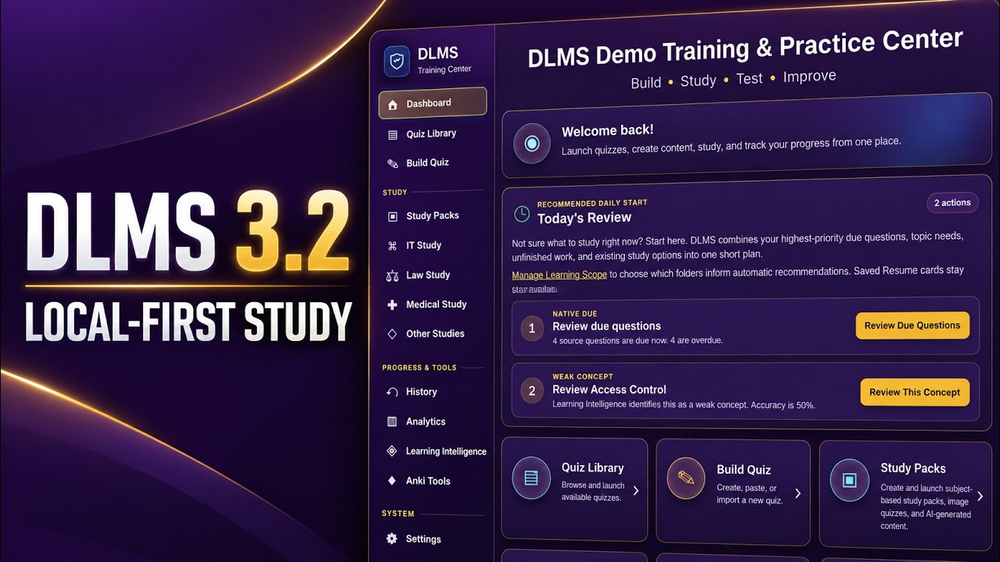
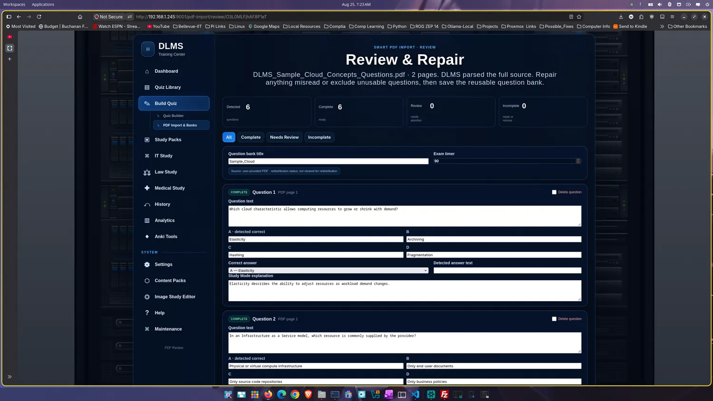
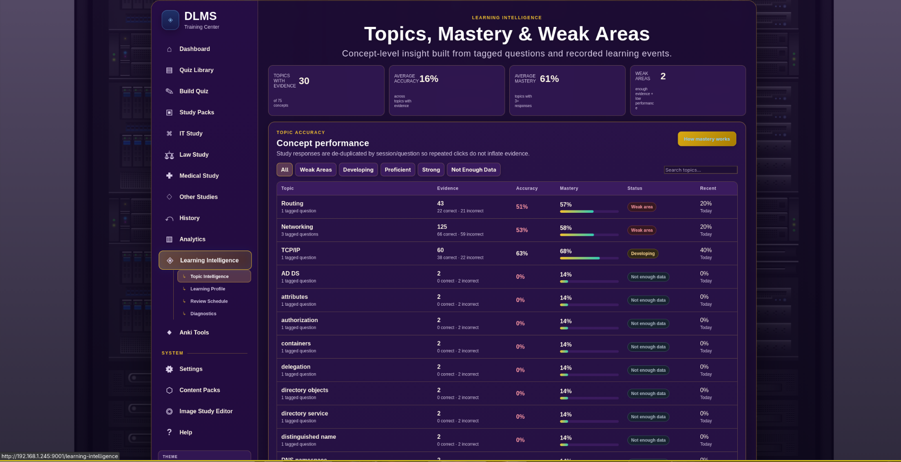
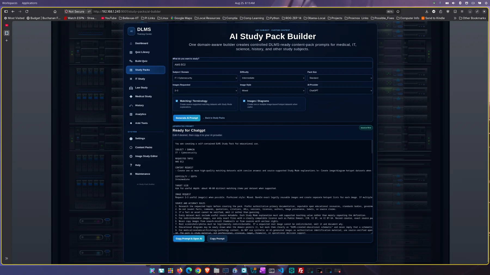

# DLMS

**A private, local-first workspace for building, studying, and improving your own learning material.**

## Choose your DLMS

**Want the original stable release? [Download browser-based DLMS 3.3.0](https://github.com/drakahari/DLMS_next/releases/tag/v3.3.0).**

| Choose | What you get |
| --- | --- |
| **Original browser-based DLMS — stable 3.3.0** | Runs on your computer and opens in your preferred browser. Choose this for the established stable release. It can also be deliberately configured as a server. |
| **DLMS Desktop — Preview 1** | Opens in its own application window. **Local mode** runs on your computer; **Server mode** connects to an existing DLMS server you choose. Choose this if you want to try the Desktop preview. |

**Both editions can be used locally.** A browser interface does not mean a cloud service. Local use needs neither a hosted DLMS account nor a separate DLMS server. External AI and remote Server connections need network access. The two editions do not automatically share or synchronize data. Keep using the original release if it suits you.

[Go to stable downloads](#download-the-original-stable-release) · [Go to Desktop preview downloads](#download-dlms-desktop--previews) · [More about editions and data](docs/choose-your-dlms.md).

<a id="installation-and-releases"></a>

## Download the original stable release

Choose **one package for your system** from the original browser-based **DLMS 3.3.0** release:

| Your system | Download |
| --- | --- |
| Windows 11 x86-64 | [DLMS-3.3.0-windows11-x86_64.zip](https://github.com/drakahari/DLMS_next/releases/download/v3.3.0/DLMS-3.3.0-windows11-x86_64.zip) |
| Fedora 44 x86-64 | [DLMS-3.3.0-fedora44-x86_64.tar.gz](https://github.com/drakahari/DLMS_next/releases/download/v3.3.0/DLMS-3.3.0-fedora44-x86_64.tar.gz) |
| Ubuntu 24.04 x86-64 | [DLMS-3.3.0-ubuntu24.04-x86_64.tar.gz](https://github.com/drakahari/DLMS_next/releases/download/v3.3.0/DLMS-3.3.0-ubuntu24.04-x86_64.tar.gz) |
| Ubuntu 26.04 x86-64 | [DLMS-3.3.0-ubuntu26.04-x86_64.tar.gz](https://github.com/drakahari/DLMS_next/releases/download/v3.3.0/DLMS-3.3.0-ubuntu26.04-x86_64.tar.gz) |
| Mac with Apple Silicon (not Intel) | [DLMS-3.3.0-macos-arm64.zip](https://github.com/drakahari/DLMS_next/releases/download/v3.3.0/DLMS-3.3.0-macos-arm64.zip) |

<a id="macos-apple-silicon"></a>

**Open it:** extract the archive and run its DLMS executable; on Mac, open the extracted `DLMS.app` in Finder. Follow the included `README.txt` for your platform. The local interface normally opens in your browser; if needed, visit [http://127.0.0.1:9001/](http://127.0.0.1:9001/). These packages are unsigned; the Mac app is not notarized. Use only the operating system's normal approval flow; stop if approval is unavailable or the system reports malware or damage. Do not disable security protections or remove quarantine.

Before upgrading an existing installation, keep a verified backup: [3.3.0 release notes and rollback guidance](docs/releases/3.3.0.md). Replacing an executable does not undo a data migration.

## Download DLMS Desktop — previews

**Ordinary users need only their platform's app download below**, plus any system prerequisites listed under installation. You do not need Python, GitHub's “Source code” archives or the large dependency-source archives to run the packaged app.

| Your system | App download — Preview 1 |
| --- | --- |
| Windows 11 x86-64 | [Windows installer (.exe)](https://github.com/drakahari/DLMS_next/releases/download/desktop-v3.3.0-preview1-windows/DLMS-Desktop-3.3.0-preview1-windows11-x86_64-Setup.exe) |
| Linux x86-64 | [Linux AppImage](https://github.com/drakahari/DLMS_next/releases/download/desktop-v3.3.0-preview1/DLMS-Desktop-3.3.0-preview1-linux-x86_64.AppImage) |
| Mac with Apple Silicon (not Intel) | [Mac DMG](https://github.com/drakahari/DLMS_next/releases/download/desktop-v3.3.0-preview1-macos/DLMS-Desktop-3.3.0-macos-arm64-preview1.dmg) |

These are **previews, not the stable release**. [Windows details](https://github.com/drakahari/DLMS_next/releases/tag/desktop-v3.3.0-preview1-windows), [Linux details](https://github.com/drakahari/DLMS_next/releases/tag/desktop-v3.3.0-preview1) and [Mac details](https://github.com/drakahari/DLMS_next/releases/tag/desktop-v3.3.0-preview1-macos) record their tested systems and limitations. Desktop keeps separate profiles; installing it does not automatically import your browser-based DLMS data.

### Install and open Desktop on Windows

**Requires Windows 11 x86-64, .NET Framework 4.8 and a protected machine-wide Microsoft WebView2 Evergreen Runtime 155.0.4283.45 or newer.** Setup does not install prerequisites; per-user/AppData-only WebView2 runtimes are unsupported.

1. Download and run `DLMS-Desktop-3.3.0-preview1-windows11-x86_64-Setup.exe`. The per-user installer is **unsigned**, so Windows may warn. Proceed only if you trust the download and Windows permits it; do not disable protections to install it.
2. Finish setup, then open **DLMS Desktop** from the Start menu. The preview retains the **DLMS Desktop WebView2 Candidate** menu folder for compatibility. Desktop shortcut creation and opening the app at the end of setup are optional and initially unchecked.

### Open Desktop on Linux

Use the AppImage for a standalone trial. **Normal AppImage mounting requires FUSE.** The exact preview was tested on Fedora 44/COSMIC Wayland; native Ubuntu and Omarchy acceptance remains pending.

1. Save the AppImage in a folder you want to keep. Open a terminal in that folder.
2. Make it executable and start a named preview profile:

   ```sh
   chmod u+x DLMS-Desktop-3.3.0-preview1-linux-x86_64.AppImage
   ./DLMS-Desktop-3.3.0-preview1-linux-x86_64.AppImage --profile preview01
   ```

It needs no mandatory installation or desktop integration. The AppImage is **unsigned**; keep Chromium sandboxing enabled. See alternatives below if FUSE is unavailable.

### Install and open Desktop on Mac

**Apple Silicon only; qualified on macOS 26.6.2.** Intel Macs and other macOS versions are not qualified by this preview. The app is **ad hoc signed, without Developer ID or notarization**.

1. Open the DMG and copy **DLMS Desktop.app** to a location you choose. Use a separate folder if another DLMS app is already there.
2. Double-click the copied app in Finder.
3. If macOS says it cannot verify the app, choose **Done**, then **System Settings → Privacy & Security → Open Anyway** for this app. Confirm **Open Anyway** (or **Open**) and authenticate personally with your existing password or Touch ID.

That per-app procedure was verified on the quarantined preview. If approval is unavailable or macOS reports malware or damage, stop. Do not disable Gatekeeper or remove quarantine. Managed Macs may prohibit approval.

### Alternative Linux installation

- **No FUSE:** explicitly extract and run the same AppImage with `APPIMAGE_EXTRACT_AND_RUN=1 ./DLMS-Desktop-3.3.0-preview1-linux-x86_64.AppImage --profile preview01`. Keep Chromium sandboxing enabled.
- **One-folder bundle:** [download the Linux .tar.zst bundle](https://github.com/drakahari/DLMS_next/releases/download/desktop-v3.3.0-preview1/DLMS-Desktop-3.3.0-preview1-linux-x86_64.tar.zst) if you want the optional Fedora per-user installation/manual-maintenance manager. Extract into a new folder, keep the full bundle together and follow the [Linux release instructions](https://github.com/drakahari/DLMS_next/releases/tag/desktop-v3.3.0-preview1). Installation previews its locations and requires confirmation; it is not automatic.

The original browser-based 3.3.0 release has distribution-specific Linux `.tar.gz` packages, not an AppImage. The older browser-based `DLMS-3.2.2-linux-x86_64.AppImage` remains an older-release option; it is separate from this Desktop preview.

### Getting started

1. In Desktop, choose **Local** to work on this computer. Choose **Server** only to connect to an existing deployment whose address you know; it uses that server's data, not your Local profile.
2. Start with **Build Quiz**, **PDF & Image Import**, a **Study Pack**, or a subject study area. The original stable archives also include `sample_quiz.txt` for trying text import.
3. Review imported content, then use **Study Mode** or **Exam Mode**. History, Analytics and Learning Intelligence help you decide what to revisit.
4. Use **Settings → Backup & Restore** to keep backups outside the live data folder. Do not point the two editions at one live database.

Close Desktop normally when finished and follow any pending-work warning. In browser-based DLMS, use **Shutdown DLMS** in the sidebar to stop the local process explicitly. Its optional browser-presence shutdown applies only in eligible local sessions, not a general Server shutdown guarantee. If the local process is still running, revisit its address rather than starting another copy.

[Read the user manual](docs/user-manual/README.md) for the everyday workflows.

DLMS 3.3.0 includes durable Study history, optional Exam Plans,
earned-certification and training records, and 26 manually selected themes.
See the [release notes](docs/releases/3.3.0.md) and
[release evidence](docs/releases/3.3.0-RELEASE-CHECKLIST.md). The five original browser-based native
packages were built from commit `af6766a8c59da513870014141c60aaa1edd1d232`.
All five native builders passed; broader packaged OCR, persistence and restore
checks ran on Fedora. The additional Ubuntu 24.04 harness was canceled, so
those broader checks are not claimed for every platform.

DLMS is a single-user learning-management and study application that runs on
your computer. It combines quiz authoring, document and image import, Study and
Exam modes, learning history, targeted review, reusable Study Packs, and Anki
export in one desktop-style experience. The original edition opens in your browser; Desktop uses a dedicated window.
The application and its data remain local by default in Local mode.

DLMS is an open-source, non-commercial project for personal learning, exam
preparation, technical training, and other self-directed study. It is not a
SaaS product, cloud service, or enterprise multi-user platform.

## Why DLMS

- **Private by default.** No account, hosted database, or cloud deployment is
  required. OCR runs locally in the packaged releases.
- **Built around learning, not only scoring.** Study feedback, concepts,
  confidence, missed-question review, Learning Intelligence, and spaced review
  turn attempts into a practical next-study plan.
- **Flexible input, careful output.** Create material manually or from text,
  PDFs, screenshots, images, matching lists, Study Packs, and structured output
  from an external AI. Ambiguous imports go through Review & Repair instead of
  being silently treated as correct.
- **No required AI API subscription.** DLMS can prepare prompts and validate
  returned content without calling an AI-provider API or storing an API key.
  Using an external provider is optional and remains under the user's control.
- **A desktop-style local experience.** The original packages open the local
  browser UI; Desktop manages its Local backend and application window. Neither
  local option requires managing a separate database or server.

## Learn DLMS

### Watch DLMS in Action

See how DLMS 3.2 brings local-first importing, quiz practice, timed assessments,
richer question types, and learning-guided review into one desktop workspace.

[](https://www.youtube.com/watch?v=nrUz3umt8vk)

[Watch the 7:45 DLMS 3.2 overview on YouTube](https://www.youtube.com/watch?v=nrUz3umt8vk)

### Read the User Manual

Follow step-by-step guidance for setup, importing content, Study and Exam modes,
Learning Intelligence, Packs, Anki, backups, and everyday workflows.

[Read the DLMS User Manual](docs/user-manual/README.md)

## Highlights

### Build and import study material

- Create single- or multiple-answer quizzes manually, paste structured text,
  upload question files, or import matching/terminology material.
- Use **PDF & Image Import** for selectable-text question banks and
  glossary/terminology documents.
- Use bundled local OCR for screenshot batches, selected low-text scanned-PDF
  pages, and supported mixed text/raster question layouts.
- Send uncertain PDF, OCR, and structured-AI results through **Review &
  Repair**, where questions, choices, answer mode, explanations, provenance,
  and unassigned text can be inspected before publication.
- Build ordinary image questions and hotspot activities, with non-destructive
  image overlays and editable target regions.

### Study, test, and improve

- Choose **Study Mode** for immediate feedback and explanations, or **Exam
  Mode** for a timed, test-like attempt.
- Resume eligible in-progress Study or Exam sessions after an interruption.
- Browse durable **Study History** separately from **Exam History** and its
  clearly labeled legacy Study results. Analytics summarizes saved results.
- Use optional **Exam Plans** for explainable daily targets within your selected
  study days and estimated time budget; Study next keeps other review options available.
- Attach reusable **concepts** to questions so Learning Intelligence can show
  topic accuracy, evidence, mastery, and weak areas.
- Generate **Smart Review** sets from weak concepts and **Spaced Review** sets
  from due material. Diagnostics can surface recurring choice confusions and
  question-quality signals for inspection.

### Organize and reuse content

- Search, filter, hide, edit, reorder, and organize quizzes into custom folders
  in the **Quiz Library**; export one quiz or a human-readable library reference.
- Install validated **Study Packs** containing matching, multiple-choice,
  mixed, image, or hotspot material. Content Packs can be inspected, exported,
  and moved between DLMS installations.
- Work in dedicated IT, Medical, Law, and Other Studies areas. Law Study also
  supports case-review packets, briefs, Socratic work, IRAC practice, notes,
  flashcards, and exports.
- Create portable backups, validate them before restore, and preserve a safety
  backup while applying a restore.

### Record earned certifications and training

- Keep earned, expired and non-expiring credentials from any issuer, with
  independent badge artwork and official certificate evidence.
- Log exact learning hours/minutes and choose which credentials a course may
  support. Estimated, submitted and user-recorded accepted credit stay distinct.
- Keep personal planning deadlines, recorded renewal deadlines and expiration
  separate. Optional AI matching remains a reviewed copy-and-manual-paste workflow.

### Continue outside DLMS

- Build custom Anki decks from selected quiz questions, missed questions, and
  Law Study material.
- Export Anki packages or TSV data, or create printable physical flashcards.
- Export reusable Content Packs and classic quiz text for study or transfer.

### Personal, accessible desktop experience

- Choose from **26 manual themes**, including the existing adapted Ethereal,
  using the sidebar selector or Appearance settings. No Omarchy installation is needed.
- Choose dashboard and sidebar visibility independently in **Layout & navigation**.
- Use semantic controls, visible focus states, keyboard-operable quiz choices,
  and touch/keyboard alternatives for matching activities.
- Keep all active data in the current user's application-data directory, with
  no system-wide database or background service required by default.

## What makes DLMS different

### Import uncertainty stays visible

Document parsing and OCR are probabilistic. DLMS preserves source context,
reports incomplete or low-confidence records, and requires deliberate review
where correctness is not established. That makes imported material repairable
without pretending every extraction is trustworthy.

### Learning Intelligence reuses your own evidence

DLMS connects concept-tagged Study interactions and completed Exam responses to
topic-level views. Smart Review and Spaced Review select from questions you
already own; they do not invent new questions or rewrite recorded answers.

### AI assistance without an embedded provider dependency

The External AI Quiz Builder creates a provider-neutral prompt, accepts bounded
structured quiz output, validates it, and stages it for review. The AI Study
Pack Builder follows a separate prompt → ZIP → validate → install workflow.
DLMS does not send prompts or retrieve responses automatically, so the learner
chooses whether and where external AI is used.

### Reusable sources remain separate from practice copies

Question banks, terminology banks, and Study Packs can generate focused quizzes
without reparsing the original source. This supports repeated practice while
keeping source provenance and installed content manageable.

## Screenshots

These are existing screenshots from the DLMS 3.1.0 Help Center. They remain
representative of the pictured workflows; their embedded version text is
historical and was not regenerated for this release.

| Smart PDF Review & Repair | Learning Intelligence | AI Study Pack Builder |
| --- | --- | --- |
| [](static/help_assets/sample_cloud_questions_smart_pdf_review-repair.webp) | [](static/help_assets/learning-topics.webp) | [](static/help_assets/ai_study_pack_builder.webp) |

### Optional Omarchy companion

Omarchy users can optionally install the separately maintained
[DLMS Companion for Omarchy](https://github.com/drakahari/omarchy-dlms). Its
Quattro bar widget shows due questions and opens DLMS review in the browser.
The companion targets browser-based DLMS and is optional. The original Linux
packages work independently; Desktop also needs no Omarchy plugin. The companion
is not bundled with DLMS packages or source. See the plugin repository for installation and update
instructions.

## Data, privacy, and portability

Browser-based DLMS creates its data directory on first run and initializes its
local database and configuration automatically:

- Windows: `%APPDATA%\DLMS`
- macOS: `~/Library/Application Support/DLMS`
- Linux: `~/.local/share/DLMS`

Desktop uses separate, platform-specific preview profiles; see [data locations](docs/choose-your-dlms.md#where-your-data-lives). Do not manually share a live data directory between editions.

Use **Settings → Backup & Restore** to download a portable backup, validate a
backup before restoring it, or migrate persistent DLMS data. Keep important
backups outside the live application-data directory.

Browser-based DLMS binds to `127.0.0.1:9001` by default. An intentional non-loopback bind is
an advanced trusted-LAN/server configuration: DLMS has no user authentication,
so it should not be exposed directly to the public internet.

### Browser-based launch and server controls

- `--browser` forces a browser-launch attempt.
- `--no-browser` suppresses automatic launch.
- `DLMS_NO_BROWSER=1` also suppresses launch and takes precedence over
  `--browser`.
- `--host 0.0.0.0` deliberately enables access through the host's network
  interfaces; use it only on a trusted, appropriately firewalled LAN.

Headless/SSH detection affects automatic browser launch, not the network bind.

## Documentation

- [DLMS User Manual](docs/user-manual/README.md) provides the canonical Markdown
  guide; the in-application **Help Center** offers guidance while using DLMS.
- [3.3.0 release evidence](docs/releases/3.3.0-RELEASE-CHECKLIST.md) records
  frozen source, approved packages and validation limits.
- [3.2.2 release checklist](docs/releases/3.2.2-RELEASE-CHECKLIST.md) records the
  source-freeze and native-package gates for maintainers.
- [OCR setup and frozen packaging](docs/OCR_PACKAGING.md) explains source-mode
  Tesseract setup and the strict native OCR bundle contract.
- [Native release verification](docs/RELEASE_VERIFICATION.md) documents build,
  artifact, final-package, checksum, and native smoke-test gates.
- [Engineering audit summaries](docs/audits/) record evidence-based product and
  release reviews; they are not third-party certifications or guarantees.

## Developers, licensing and download verification

Running a packaged app does **not** require downloading source archives or installing build tools. The accompanying sources, notices, provenance and checksums are for verification, licensing, redistribution and rebuilding. OS prerequisites listed above still apply. Checksums detect file mismatches; they are not independent publisher signatures.

| Edition/platform | Checksums and materials | Build/replacement guidance |
| --- | --- | --- |
| Original stable 3.3.0 | [SHA256SUMS.txt](https://github.com/drakahari/DLMS_next/releases/download/v3.3.0/SHA256SUMS.txt), [release/source](https://github.com/drakahari/DLMS_next/releases/tag/v3.3.0) | [Native release verification](docs/RELEASE_VERIFICATION.md), [OCR packaging](docs/OCR_PACKAGING.md) |
| Windows Desktop preview | [SHA256SUMS.txt](https://github.com/drakahari/DLMS_next/releases/download/desktop-v3.3.0-preview1-windows/SHA256SUMS.txt), [all sources/notices and final installer supplement](https://github.com/drakahari/DLMS_next/releases/tag/desktop-v3.3.0-preview1-windows), [redistribution](https://github.com/drakahari/DLMS_next/releases/download/desktop-v3.3.0-preview1-windows/REDISTRIBUTION.md) | [Build and replacement](https://github.com/drakahari/DLMS_next/releases/download/desktop-v3.3.0-preview1-windows/BUILD_AND_REPLACEMENT.md) |
| Linux Desktop preview | [SHA-256 values and all source/notice companions](https://github.com/drakahari/DLMS_next/releases/tag/desktop-v3.3.0-preview1) | [Linux build, notices and replacement guide](docs/linux-desktop-preview-build.md) |
| Mac Desktop preview | [SHA256SUMS](https://github.com/drakahari/DLMS_next/releases/download/desktop-v3.3.0-preview1-macos/SHA256SUMS), [source index](https://github.com/drakahari/DLMS_next/releases/download/desktop-v3.3.0-preview1-macos/SOURCE_INDEX.json), [all sources/notices and provenance](https://github.com/drakahari/DLMS_next/releases/tag/desktop-v3.3.0-preview1-macos), [redistribution](https://github.com/drakahari/DLMS_next/releases/download/desktop-v3.3.0-preview1-macos/REDISTRIBUTION.md) | [Build and replacement](https://github.com/drakahari/DLMS_next/releases/download/desktop-v3.3.0-preview1-macos/BUILD_AND_REPLACEMENT.md) |

The application and original Desktop badge are MIT; dependencies retain their own terms. See [LICENSE](LICENSE), [Desktop source licensing](docs/desktop-license.md) and [artwork provenance](desktop_assets/ICON_PROVENANCE.md). Anyone redistributing a Desktop binary must retain its applicable notices and corresponding-source materials, including the final Windows installer supplement and the platform-specific source mappings. Ordinary users need only their app, not every source companion.

## Development and contributing

Ordinary users should prefer the packaged releases. To run from source:

```bash
python -m venv .venv
source .venv/bin/activate
python -m pip install -r requirements-lock.txt
python app.py
```

On Windows, activate with `.venv\Scripts\activate`. Normal selectable-text PDF
imports work without Tesseract in source mode; screenshot and scanned-page OCR
need the local dependencies documented in
[`docs/OCR_PACKAGING.md`](docs/OCR_PACKAGING.md).

Before proposing a change, keep it focused, preserve local-data compatibility,
and run the relevant tests. The standard non-browser suite is:

```bash
python -m pytest -q -p no:cacheprovider -m "not browser"
```

See [CONTRIBUTING.md](CONTRIBUTING.md) for the test environment, Firefox
workflow expectations, fixture privacy rules, and release-impact guidance.

Compatible dependency ranges are recorded in `requirements.txt`; the verified
3.3.0 environment is pinned in `requirements-lock.txt`. This project is
available under the [MIT License](LICENSE).

<details>
<summary><strong>Maintainer release notes</strong></summary>

### Native build inputs

Build natively from the reviewed frozen commit using the recommended orchestrator:

```text
python -m pip install -r requirements-build.txt
python tools/build_native_release.py --target fedora44-x86_64 --expected-commit FULL_40_CHARACTER_RELEASE_COMMIT --expected-version 3.3.0
```

Replace the SHA placeholder and select the actual native target. Prepare a native
OCR bundle first, or use the documented `--prepare-ocr` options. See
[Native Release Verification](docs/RELEASE_VERIFICATION.md#recommended-one-command-native-release)
for all six targets and prerequisites. The command creates fresh isolated build
outputs, runs OCR and version-aware native smoke gates, packages locally, and
writes checksums and an acceptance summary. It never overwrites earlier packages.

The native builder recognizes these target names; the Omarchy target was not
published for 3.3.0:

- `DLMS-3.3.0-fedora44-x86_64`
- `DLMS-3.3.0-ubuntu24.04-x86_64`
- `DLMS-3.3.0-ubuntu26.04-x86_64`
- `DLMS-3.3.0-omarchy-quattro-x86_64`
- `DLMS-3.3.0-windows11-x86_64.exe`
- `DLMS-3.3.0-macos-arm64.zip`

The orchestrator performs the following archive step on Apple Silicon. For
manual diagnosis only, use the freshly built app path in place of `dist/DLMS.app`:

```bash
ditto -c -k --sequesterRsrc --keepParent dist/DLMS.app releases/DLMS-3.3.0-macos-arm64.zip
```

The bundle executable is `DLMS.app/Contents/MacOS/DLMS`. Do not place a wrapper
directory around the app or include build/runtime data.

### Final package gate

The native packaging convention names six targets. The 3.3.0 public release
contains the five packages listed above; the Omarchy package below was not
published:

- `DLMS-3.3.0-fedora44-x86_64.tar.gz`
- `DLMS-3.3.0-ubuntu24.04-x86_64.tar.gz`
- `DLMS-3.3.0-ubuntu26.04-x86_64.tar.gz`
- `DLMS-3.3.0-omarchy-quattro-x86_64.tar.gz`
- `DLMS-3.3.0-windows11-x86_64.zip`
- `DLMS-3.3.0-macos-arm64.zip`

Follow [Native Release Verification](docs/RELEASE_VERIFICATION.md) for the exact
artifact and final-package checks, native smoke tests, UAT, and checksum steps.
The tools validate structure, architecture, version, packaged resources,
runtime-data exclusions, start/routes/shutdown/restart behavior, and the final
archive layout. They do not add signing, notarization, installers, publication,
or CI release automation.

For the original browser-based native release, GitHub's automatic source archives
provide the repository source; do not upload a separately assembled source ZIP
for that packaging flow. Desktop redistribution additionally requires the exact
platform source/notice companions indexed in its release materials above.

</details>

## Project status

DLMS 3.3.0 is published. All five native builders passed, and broader packaged
OCR, Study/Exam persistence and exact backup/restore checks ran on Fedora with
synthetic data. The additional Ubuntu 24.04 harness was canceled; those Fedora
checks do not establish equivalent end-to-end behavior on every other platform.
The [release evidence](docs/releases/3.3.0-RELEASE-CHECKLIST.md) records the
limits, and the [Releases page](https://github.com/drakahari/DLMS_next/releases) is authoritative for downloads.

Desktop Preview 1 is separately published for Windows 11 x86-64, Linux x86-64 and Apple Silicon Mac. Its preview status and platform qualification limits are described in the download sections above.
