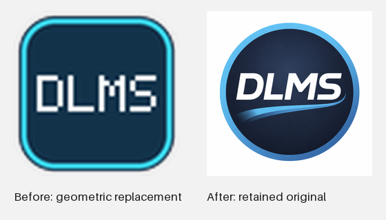

# Canonical round blue DLMS icon — shared platform handoff

Base: `5e5fa245ffb23617890d237c1d6c02a67ff093b1`. This icon-only branch restores
the exact retained master, not a redesign or a local shortcut override.



## Input and outputs

`desktop_assets/dlms-icon-master.png` is byte-identical to the original 1024×1024
PNG already at `static/favicon.ico`. SHA-256:
`be929c60a0a63373d698934930bac8af686d3a8242072e25954118f783b1af93`.
The master retains its original white surround. The historical favicon URL is
unchanged. All fourteen image files/formats/frames/hashes are recorded in
[`ICON_RESOURCES.json`](../../../desktop_assets/ICON_RESOURCES.json).

The owner identifies the image as AI-generated and confirmed use/redistribution
of the retained image and resized derivatives. Generator/service/date/prompt and
specific generation terms remain unknown. No generation record or standardized
third-party license is invented. See
[provenance](../../../desktop_assets/ICON_PROVENANCE.md). Code remains MIT;
third-party notices/pins remain intact. Old published images/packages are unchanged.

## Validation and scope

42 focused tests passed: exact master/favicon hashes, every Linux PNG size and
pixel, every ICO frame, every ICNS scale/frame, Qt QIcon loading at small/large
sizes, deterministic decoded conversion, tampered-master refusal, platform
reference contracts, recorded resource hashes, synthetic installer integrity and
source-export/preview-material contracts. The packaging tests inspect/mock spec
branches; they do not freeze an application or establish native taskbar behavior.

The first run retained two setup findings: the new ICNS converter initially used
Pillow's default resize, which failed the exact LANCZOS pixel assertion; explicit
LANCZOS frames corrected it. The primary test environment lacked PyInstaller for
three spec-contract cases; the existing project-local build tools were reused,
without installation or pin changes. The final focused run passed with those
issues resolved. Logs are retained task-locally, not included as public data.

Visual comparison confirms the round blue master, white italic lettering and
swoosh, original colors and surround. No tracing, cropping, recoloring, image
regeneration or font substitution. Native Windows/Mac/Fedora/Omarchy icon and
installer observations require future packages; none is claimed here. No broad
workflow audit is justified by this artwork/conversion-only change. All accepted
runtime/security/recovery code is unchanged except Qt's icon resource path;
installer code changes only its expected artwork digest. Dependency pins unchanged.

## Build from this PR's exact merged/reviewed commit

Use the source commit reported by the PR; do not mix generated resources from old
branches. Resources are already tracked. Optional regeneration, using the
unchanged pinned Pillow dependency:

```sh
python -m package_fedora.prepare_desktop_icons
```

Compare decoded pixels/formats and the exact master hash. Native encoder versions
can change compressed PNG/ICNS hashes; do not weaken payload integrity checks or
silently replace a reviewed artifact. Any regeneration needs a refreshed source
resource manifest and reviewed artifact provenance.

### Windows

- Retain accepted WebView2 renderer/request/focus/save and Qt host behavior.
- Rebuild the native host using `windows_webview2/build.ps1` with a fresh bounded
  BuildName: its compiler now embeds `desktop_assets/icons/windows/DLMSDesktop.ico`
  with `/win32icon`. Refresh the normal host SHA256 manifest by that existing flow.
- Both Desktop PyInstaller specs and both Inno installers use that same ICO path;
  browser-edition `DLMS.spec` derives its multi-size ICO from the same master.
- Rebuild the intended EXE and installer only after artwork approval. Verify the
  actual PE icons, installer/shortcut and running Qt taskbar window on Windows.
  The embedded WebView2 child remains non-taskbar; no C# lifecycle code changed.
- No cache reset, existing installation replacement or signing change is authorized.

### macOS

- `package_macos/DLMS-Desktop.spec`, `tools/macos_test_wrapper.py` and browser
  `DLMS.spec` use `desktop_assets/icons/macos/DLMSDesktop.icns` from this commit.
- Rebuild only the intended native bundle/DMG after artwork approval. Verify the
  actual bundle icon file and CFBundleIconFile, Finder/Dock/app-switcher rendering,
  normal quit/reopen and existing signature/payload checks. Do not rely on Finder
  custom-icon metadata or delete unrelated metadata/caches to claim success.
- No wrapper, signing, notarization, permissions or runtime changes are included.

### Linux

- Qt window/application and Desktop AppImage root icon read the 1024-pixel master.
  Browser-edition AppImage PNG derives from it. All existing specs collect the
  desktop_assets tree; no new dependency or special resource hook is needed.
- Hicolor PNGs are 16/24/32/48/64/128/256/512/1024. Compatibility
  `dlms_omarchy.png` remains at 64 pixels; the existing installer digest now binds
  its new bytes. Existing installer identity/path/ownership checks are unchanged.
- Future AppImage and managed tar must use one fresh freeze and refreshed
  inventories/notices/source provenance. Do not reuse the earlier combined
  payload and merely replace a shortcut icon.
- Managed updates intentionally preserve existing host menu/icon files. This PR
  does not change that safeguard: any future existing-install icon refresh needs
  an explicit manifest-verified plan/approval. Fresh-install paths use these new
  assets; no installed launcher, icon cache or OS setting changes here.

No platform packages have been built, installed, merged or published by this task.
